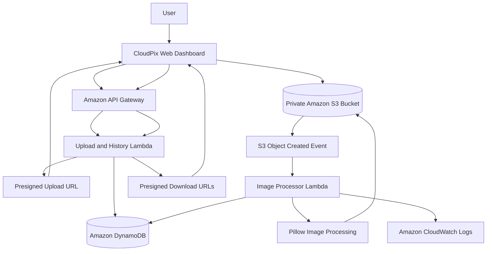

# CloudPix — A Serverless Image Processing and Storage Platform

CloudPix is a serverless image processing and storage platform that automatically generates optimized images and thumbnails when users upload images.

The platform uses Amazon S3 to store images, AWS Lambda to process them asynchronously, and Amazon DynamoDB to maintain image metadata and processing history. Users can upload images through a web dashboard, monitor processing status, view image history, and download the original and processed versions.

## Problem Statement

Uploading, resizing, and maintaining multiple versions of images manually is repetitive and time-consuming. Traditional solutions may also require continuously running servers to process images.

CloudPix addresses this problem through an event-driven, serverless architecture that automatically processes uploaded images without requiring a continuously running image-processing server.

## Project Objectives

- Develop a web-based image upload and management platform.
- Automate image resizing and thumbnail generation.
- Use serverless computing to process images on demand.
- Store original and processed images securely in Amazon S3.
- Maintain image metadata and processing history in Amazon DynamoDB.
- Provide real-time processing status through an API.
- Generate temporary download links for privately stored images.
- Implement input validation and basic cloud security controls.
- Minimize infrastructure management and unnecessary cloud resource usage.

## Key Features

### 1. Image Upload
- Upload JPG, JPEG, and PNG images.
- Support selecting images through the file picker or drag-and-drop interface.
- Validate supported file types and enforce a 10 MB upload limit in the frontend.
- Upload files directly to Amazon S3 using short-lived presigned URLs.

### 2. Automatic Image Processing
- Automatically trigger image processing when an original image is uploaded to S3.
- Use AWS Lambda and the Pillow Python library to process images.
- Generate an optimized image with a maximum dimension of 800 × 800 pixels.
- Generate a thumbnail with a maximum dimension of 200 × 200 pixels.
- Preserve the original image's aspect ratio.
- Preserve transparency when processing PNG images.

### 3. Image Storage
- Store original images under the `originals/` prefix.
- Store processed images under the `processed/` prefix.
- Keep S3 objects private rather than making uploaded images publicly accessible.
- Provide temporary presigned URLs for authorized download operations.

### 4. Processing Status and History
- Record image information in Amazon DynamoDB.
- Track processing states such as Pending, Processing, Completed, and Failed.
- Retrieve previously uploaded images through the history API.
- Store image dimensions, file sizes, and processing metadata when available.

### 5. Image Downloads
- Retrieve temporary download links for original images, resized images, and thumbnails.
- Allow users to download available image variants through the dashboard.

### 6. Error Handling
- Reject unsupported image formats.
- Validate uploaded image contents on the backend.
- Reject oversized or invalid image data.
- Record processing failures and useful diagnostic information in CloudWatch Logs.

## Technology Stack

| Component | Technology |
|---|---|
| Frontend | HTML, CSS, JavaScript |
| Backend | Python |
| Image Processing | Pillow |
| Serverless Compute | AWS Lambda |
| Object Storage | Amazon S3 |
| Database | Amazon DynamoDB |
| API | Amazon API Gateway |
| Monitoring and Logs | Amazon CloudWatch |
| Infrastructure as Code | AWS SAM |
| Testing | Python unittest |
| CI/CD Testing | GitHub Actions |
| Version Control | Git and GitHub |

## System Architecture



## How CloudPix Works

1. The user opens the CloudPix web dashboard and selects an image.
2. The frontend validates the file type and size.
3. The frontend sends an API request containing the filename, content type, and file size.
4. The upload handler creates a Pending record in DynamoDB and generates a short-lived presigned S3 upload URL.
5. The browser uploads the original image directly to the private S3 bucket.
6. The S3 Object Created event triggers the image-processing Lambda function.
7. The Lambda function validates the image and uses Pillow to generate the resized image and thumbnail.
8. The original and processed files remain stored in S3.
9. The processor updates the image's status and metadata in DynamoDB.
10. The dashboard retrieves the processing status and image history through API Gateway.
11. When available, presigned download URLs allow the user to retrieve the original and processed images.

## AWS Services Used

### Amazon S3
Stores original images and generated image variants. The bucket is configured to block public access.

### AWS Lambda
Runs the upload/history API logic and processes images when triggered by S3 events.

### Amazon DynamoDB
Stores image records, processing status, object keys, dimensions, sizes, and other supported metadata.

### Amazon API Gateway
Exposes HTTP endpoints used by the frontend to request upload URLs, retrieve history, and check image status.

### Amazon CloudWatch
Collects Lambda execution logs and helps troubleshoot processing errors.

### AWS SAM
Defines the application's AWS infrastructure and supports validation, building, and deployment.

## Repository Structure

```text
CloudPix/
├── frontend/
│   ├── index.html
│   ├── styles.css
│   └── app.js
├── backend/
│   ├── upload_handler/
│   │   └── app.py
│   └── image_processor/
│       └── app.py
├── tests/
├── events/
│   └── s3-object-created.json
├── .github/
│   └── workflows/
│       └── tests.yml
├── template.yaml
├── samconfig.toml
├── requirements.txt
├── README.md
├── SETUP.md
└── TESTING.md
```

## Installation and Local Testing

### Prerequisites

Install the following tools:

- Python 3.12
- Git
- AWS CLI
- AWS SAM CLI
- An AWS account for cloud deployment
- A modern web browser

AWS credentials are required for deployment and live AWS integration, but the local unit tests do not require a deployed AWS environment.

### Step 1: Clone the Repository

```bash
git clone https://github.com/Kashish811/CloudPix.git
cd CloudPix
```

### Step 2: Install Python Dependencies

```bash
python -m pip install -r requirements.txt
```

### Step 3: Run Unit Tests

```bash
python -m unittest discover -s tests -v
```

Refer to `TESTING.md` for the test coverage and the procedures for verifying the deployed application.

### Step 4: Follow the safe setup procedure

Use `SETUP.md` for local validation and the isolated test-stack procedure. Do not run `sam deploy --guided` from this checkout: the existing `samconfig.toml` may point at the deployed `cloudpix` stack. Review a pending test-stack change set and get separate approval before executing it.

## API Endpoints

The API base URL is obtained from the deployed SAM stack's `ApiBaseUrl` output.
The frontend reuses the API base configured in the browser's CloudPix settings. For the currently specified deployment, that base URL is `https://45g0v7hvbh.execute-api.ap-south-1.amazonaws.com/prod`; confirm the target environment before using Delete. Do not test deletion with real images.

| Method | Endpoint | Purpose |
|---|---|---|
| POST | `/uploads` | Request a presigned upload URL and create an image record |
| GET | `/history` | Retrieve recent image records |
| GET | `/images/{image_id}` | Retrieve an image's status, metadata, and available download URLs |
| DELETE | `/images/{image_id}` | Delete the image's S3 objects and DynamoDB record |

### Example Upload Request

```json
{
  "filename": "sample.jpg",
  "content_type": "image/jpeg",
  "size": 12345
}
```

The `size` field must contain the actual file size in bytes. The browser uploads the file using the returned presigned URL and the required content type.

## Security Considerations

CloudPix incorporates several basic security measures:

- Amazon S3 blocks public access.
- Browser code does not contain AWS access keys.
- Short-lived presigned URLs are used for upload and download operations.
- Uploaded image contents are validated by the backend.
- File size and image dimensions are checked to reduce the risk of excessive processing.
- Generated object keys avoid relying on user-provided filenames as storage paths.
- AWS permissions are defined through the SAM infrastructure configuration.
- CloudWatch logs help identify processing failures.
- The local CSPM checker statically reviews selected template settings; see [`SECURITY.md`](SECURITY.md). It does not inspect live AWS resources.

### Known Security Limitations

The current project intentionally has no API authentication. Anyone who can reach the API can request upload URLs, read shared image history/statuses, and delete an image when its ID is known. Keep evaluation limited to a controlled test environment and non-sensitive images; do not treat the API as suitable for public or production use.

Before making the application publicly available, configure appropriate authentication, authorization, API throttling, and a restrictive CORS origin. Review the IAM policies and data-access model before using real or sensitive images.

For the Unit 4 CSPM presentation, see [`SECURITY.md`](SECURITY.md). For a CloudWatch walkthrough of the existing image processor, see [`MONITORING.md`](MONITORING.md).

## Cost Considerations

CloudPix uses serverless services, but serverless does not automatically mean completely free.

Depending on usage, AWS charges may apply to:

- Amazon S3 storage, requests, and data transfer.
- AWS Lambda invocations and execution duration.
- Amazon API Gateway requests.
- Amazon DynamoDB requests and storage.
- Amazon CloudWatch log ingestion and retention.
- Deployment artifacts and related storage.

Actual charges depend on the AWS Region, account eligibility, service usage, and current pricing.

### Cost-Control Recommendations

- Use small test images.
- Avoid repeated uploads when they are unnecessary.
- Monitor resource usage and AWS billing.
- Review unused test resources and any cleanup plan before acting.
- Follow `SETUP.md` and get separate approval before cleaning up an isolated test stack. Do not target the deployed `cloudpix` stack without a production-specific review.

Use `SETUP.md` for isolated test-stack guidance. Stack or data cleanup requires a separate review and approval.

## Screenshots

Add screenshots after running and verifying the application.

Suggested screenshots:

1. CloudPix dashboard.
2. Image upload interface.
3. Processing status.
4. Completed image results.
5. Image history.
6. Original, resized, and thumbnail downloads.
7. Amazon S3 bucket showing stored objects.
8. DynamoDB record showing image metadata and processing status.
9. CloudWatch logs showing a successful processing invocation.

Only include AWS screenshots that represent resources and tests you have actually verified.

## Project Links

- **GitHub Repository:** https://github.com/Kashish811/CloudPix
- **Hosted Frontend:** Add the actual frontend deployment URL after hosting it.
- **API Gateway:** Use the `ApiBaseUrl` output from the deployed SAM stack.

The API URL and frontend deployment URL are different. The frontend URL is the link users open to access the dashboard.

## Testing

Run the local unit tests using:

```bash
python -m unittest discover -s tests -v
```

The tests cover image-processing behavior and selected backend functionality. They do not, by themselves, verify live AWS integration.

Refer to `TESTING.md` for detailed local testing, API checks, error-path tests, and end-to-end AWS verification.

## Future Enhancements

Potential future improvements include:

- User authentication and role-based access control.
- Per-user image libraries.
- Additional output formats and configurable image dimensions.
- More detailed image metadata and analytics.
- Improved monitoring and operational alerts.
- Usage quotas and rate limiting.
- Automated frontend hosting and deployment.

These are possible extensions and should not be considered implemented unless they have actually been developed and tested.

## License

This project was developed as an academic mini-project. Add an appropriate open-source license if you intend to distribute the repository publicly.
